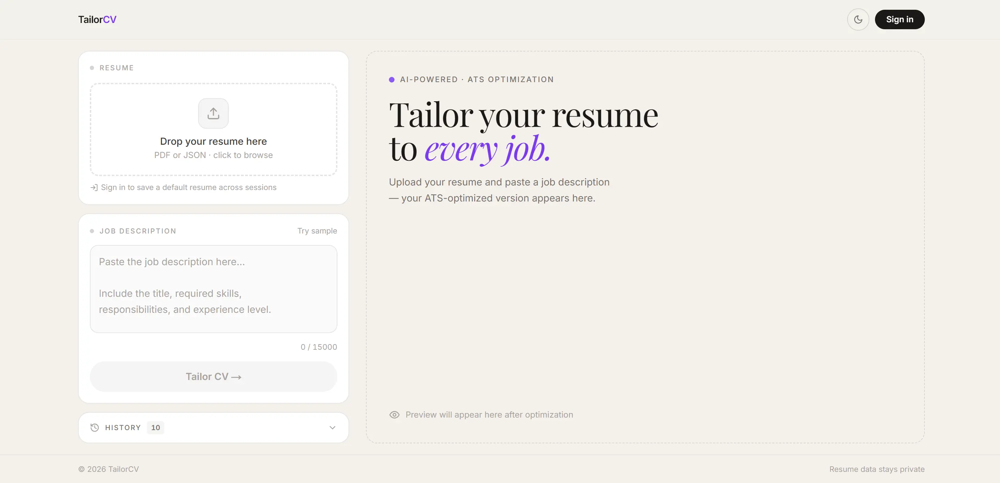

# TailorCV — AI-Powered ATS Resume Optimizer

**Live demo:** [tailorcv.harsh-p.dev](https://tailorcv.harsh-p.dev)



An AI-powered resume tailoring tool that rewrites your resume for a specific job description, maximizes ATS keyword coverage, and exports to a pixel-perfect PDF or Word document.

---

## Table of Contents

- [Features](#features)
- [Architecture](#architecture)
- [Data Flow](#data-flow)
- [Project Structure](#project-structure)
- [API Routes](#api-routes)
- [AI Model Fallback Chain](#ai-model-fallback-chain)
- [Tech Stack](#tech-stack)
- [Database Schema](#database-schema)
- [Resume JSON Format](#resume-json-format)
- [Environment Variables](#environment-variables)
- [Getting Started](#getting-started)
- [Deployment](#deployment)

---

## Features

| Feature | Details |
|---|---|
| **AI Tailoring** | Rewrites bullets + summary to embed every JD keyword verbatim. Never fabricates experience. |
| **ATS Score** | Before/after keyword match score (0–100) calculated against extracted JD requirements. |
| **Keyword Highlight** | Newly added keywords highlighted in yellow in the live preview. |
| **Side-by-Side View** | Toggle between original and optimized resume. |
| **Export PDF** | Pixel-perfect Letter-size PDF via Puppeteer + Tailwind CDN rendering. |
| **Export DOCX** | Word document with Arial font, blue theme, right-aligned dates, clickable hyperlinks. |
| **Resume Upload** | Upload master resume as PDF (text-based) or JSON — AI parses it into structured data. |
| **History** | Last 10 optimizations saved in localStorage; synced to Supabase cloud when signed in. |
| **Default Resume** | Save resume to your profile — auto-loaded on every login across devices. |
| **Dark Mode** | Full dark/light theme with system default detection. |
| **Authentication** | Email/password sign-in via Supabase Auth. No account required for full functionality. |
| **Multi-Model Fallback** | Automatically retries with a different Groq model on rate-limit or quota errors. |

---

## Architecture

```
┌─────────────────────────────────────────────────────────────────────────┐
│                          BROWSER (React / Next.js 14)                   │
│                                                                         │
│  ┌──────────────┐  ┌──────────────────────┐  ┌─────────────────────┐   │
│  │ ResumeUpload │  │ JobDescriptionInput  │  │   ResumePreview     │   │
│  │              │  │                      │  │                     │   │
│  │ Drag/drop    │  │ Textarea (JD text)   │  │ Rendered resume     │   │
│  │ PDF or JSON  │  │ "Tailor CV →"        │  │ Keyword highlights  │   │
│  │ Set default  │  │                      │  │ Original / Opt tab  │   │
│  └──────┬───────┘  └──────────┬───────────┘  └─────────────────────┘   │
│         │                     │                                         │
│         │ multipart/form-data │ POST { resume, jobDescription }         │
│         │                     │                                         │
│  ┌──────▼─────────────────────▼───────────────────────────────────┐     │
│  │                    page.tsx (all state here)                   │     │
│  │                                                                │     │
│  │  uploadedResume ─► uploadedResumeRef  (avoids stale closure)  │     │
│  │  result         → ResumeGenerationResult                       │     │
│  │  history[]      → localStorage + Supabase                      │     │
│  └───┬──────────────────┬──────────────────┬────────────────────-─┘     │
│      │                  │                  │                             │
│  ┌───▼────────┐  ┌──────▼──────┐  ┌───────▼──────┐                     │
│  │ ATSScoreCard│  │HistoryPanel │  │DownloadButtons│                    │
│  │ Score 0-100 │  │ Last 10     │  │ PDF / DOCX   │                     │
│  │ Keywords    │  │ Sync cloud  │  │              │                     │
│  │ Suggestions │  └─────────────┘  └──────┬───────┘                     │
│  └─────────────┘                          │                             │
└───────────────────────────────────────────┼─────────────────────────────┘
                                            │ POST
                    ┌───────────────────────┼───────────────────────┐
                    │                       │                       │
                    ▼                       ▼                       ▼
         /api/parse-resume          /api/generate          /api/download/
              (Node.js)               (Node.js)            pdf  |  docx

┌────────────────────────────────────────────────────────────────────────┐
│                        NEXT.JS API ROUTES                              │
│                                                                        │
│  /api/parse-resume                                                     │
│    PDF → pdf-parse (extract text) → Groq AI → ResumeData JSON         │
│    JSON → parse directly, no AI needed                                 │
│                                                                        │
│  /api/generate                                                         │
│    JD + masterResume → Groq AI (strict ATS prompt) →                  │
│    optimizedResume + atsScore + addedKeywords + suggestions            │
│                                                                        │
│  /api/download/pdf                                                     │
│    ResumeData → buildResumeHtml() → Puppeteer → Letter PDF            │
│    Tailwind CDN renders CSS; @page { margin: 0.5in } controls layout  │
│                                                                        │
│  /api/download/docx                                                    │
│    ResumeData → generateDOCX() → docx 8.x → .docx                    │
│    Arial font • blue borders • right-tab dates • ExternalHyperlink    │
└──────────────┬─────────────────────────────┬──────────────────────────┘
               │                             │
               ▼                             ▼
┌──────────────────────────┐   ┌─────────────────────────────────────┐
│        GROQ API          │   │              SUPABASE                │
│                          │   │                                     │
│  4 model fallback chain  │   │  Auth  — email / password           │
│  (independent quotas)    │   │                                     │
│                          │   │  resumes table                      │
│  1. llama-3.3-70b-       │   │    id, user_id, data (JSONB)        │
│     versatile (primary)  │   │    → history, up to 10 per user     │
│  2. qwen/qwen3-32b       │   │                                     │
│  3. llama-4-scout-       │   │  profiles table                     │
│     17b-16e-instruct     │   │    id, default_resume (JSONB)       │
│  4. openai/gpt-oss-20b   │   │    → auto-loads on login            │
└──────────────────────────┘   └─────────────────────────────────────┘
```

---

## Data Flow

### Upload (PDF)

```
User drops PDF file
        │
        ▼
ResumeUpload.tsx
  FormData → POST /api/parse-resume
        │
        ▼
api/parse-resume/route.ts
  pdf-parse extracts raw text (text-based PDFs only)
        │
        ▼
Groq llama-3.3-70b-versatile
  "Extract all resume fields into structured JSON..."
        │
        ▼
ResumeData JSON returned to client
  setUploadedResume(data)
  localStorage.setItem("resume_optimizer_master_resume", ...)
```

### Optimization

```
User clicks "Tailor CV →"
        │
        ▼
POST /api/generate
  { jobDescription, uploadedResume }
        │
        ▼
lib/groq.ts → generateOptimizedResume()
  Groq (model fallback chain)
  temperature: 0.3 | max_tokens: 8192 | response_format: json_object
        │
        ▼
Parse + validate JSON response
        │
        ▼
calcAtsScore(original, keywords) → originalScore
calcAtsScore(optimized, keywords) → atsScore
        │
        ▼
ResumeGenerationResult {
  id, timestamp, jobTitle, company,
  originalResume, optimizedResume,
  atsScore, originalScore,
  addedKeywords, extractedRequirements,
  suggestions, jobDescription
}
        │
        ├── setResult(data)       → renders live preview
        └── saveToHistory(data)   → localStorage + Supabase (if signed in)
```

### PDF Export

```
User clicks "Export PDF"
        │
        ▼
POST /api/download/pdf
  { resume: ResumeData, jobTitle, company }
        │
        ▼
lib/resume-html-template.ts
  buildResumeHtml(resume) → Tailwind HTML string
        │
        ▼
Puppeteer (headless Chromium)
  page.setContent(html) → waits 1.5s for Tailwind CDN
  page.pdf({ format: "Letter", margin: all zeros })
  CSS @page { margin: 0.5in } controls all spacing
        │
        ▼
Binary PDF stream → filename: Name_JobTitle.pdf
```

### DOCX Export

```
User clicks "Export DOCX"
        │
        ▼
POST /api/download/docx
  { resume: ResumeData, jobTitle, company }
        │
        ▼
lib/docx-generator.ts → generateDOCX()
  Document font: Arial (set as document default)
  Section headings: UPPERCASE, blue (#1E40AF), underline border
  Dates: right-aligned via TabStopType.RIGHT (10440 twips)
  Contact: ExternalHyperlink (mailto: / https://)
  Project links: ExternalHyperlink right-aligned via tab stop
  Achievements: sorted latest-first, date right-aligned
        │
        ▼
Binary DOCX stream → filename: Name_JobTitle.docx
```

---

## Project Structure

```
tailorcv/
├── app/
│   ├── page.tsx                      # Main UI — all state, layout, handlers
│   ├── layout.tsx                    # Root layout, ThemeProvider, AuthProvider
│   └── api/
│       ├── generate/route.ts         # POST — Groq optimization
│       ├── parse-resume/route.ts     # POST — PDF/JSON → ResumeData
│       └── download/
│           ├── pdf/route.ts          # POST — Puppeteer PDF
│           └── docx/route.ts         # POST — docx DOCX
│
├── components/
│   ├── ResumePreview.tsx             # Live resume render (forwardRef, keyword highlights)
│   ├── ATSScoreCard.tsx              # Score bar, added keywords, suggestions
│   ├── DownloadButtons.tsx           # Export PDF + DOCX buttons
│   ├── ResumeUpload.tsx              # Drag-drop upload, default resume controls
│   ├── JobDescriptionInput.tsx       # JD textarea + optimize button
│   ├── HistoryPanel.tsx              # Collapsible history list
│   ├── Header.tsx                    # Sticky nav — logo, dark mode toggle, auth
│   ├── AuthModal.tsx                 # Sign in / sign up modal (Supabase)
│   ├── UserMenu.tsx                  # Avatar dropdown — cloud sync status, sign out
│   └── ThemeProvider.tsx             # next-themes wrapper
│
├── lib/
│   ├── groq.ts                       # Groq client, multi-model fallback, ATS scoring
│   ├── resume-html-template.ts       # Tailwind HTML template for Puppeteer PDF
│   ├── docx-generator.ts             # Word document builder (Arial, tab stops, links)
│   ├── auth-context.tsx              # React context for Supabase auth session
│   ├── supabase.ts                   # Supabase browser client factory
│   ├── resume-data.ts                # Default/sample master resume
│   └── utils.ts                      # cn(), getScoreColor(), getScoreLabel()
│
├── types/
│   ├── resume.ts                     # All TypeScript interfaces
│   └── pdf-parse.d.ts                # Type declarations for pdf-parse
│
├── next.config.mjs                   # serverExternalPackages, canvas alias
├── vercel.json                       # Function timeouts, CORS headers
└── package.json
```

---

## API Routes

### `POST /api/parse-resume`

Converts a PDF or JSON resume into structured `ResumeData`.

- **PDF** — `pdf-parse` extracts text → Groq AI structures it. Fails on scanned/image PDFs.
- **JSON** — parsed directly, no AI call required.

**Request:** `multipart/form-data` with a `file` field.

**Response:**
```json
{
  "resume": {
    "personalInfo": { "name": "", "email": "", "phone": "", "location": "" },
    "summary": "",
    "experience": [{ "id": "exp1", "title": "", "company": "", "bullets": [] }],
    "education": [{ "id": "edu1", "institution": "", "degree": "", "field": "" }],
    "skills": { "technical": [], "frameworks": [], "databases": [], "cloud": [], "tools": [] },
    "projects": [{ "id": "proj1", "name": "", "bullets": [], "link": "", "github": "" }],
    "certifications": [{ "id": "cert1", "name": "", "issuer": "", "date": "", "description": "" }]
  }
}
```

---

### `POST /api/generate`

Optimizes a resume against a job description using Groq AI.

**Request:**
```json
{
  "jobDescription": "Senior Software Engineer at Acme Corp...",
  "uploadedResume": { "personalInfo": {}, "experience": [] }
}
```

**Validation (400 errors):** missing JD, missing resume, JD < 50 chars, JD > 15,000 chars.

**Response:**
```json
{
  "id": "uuid",
  "timestamp": "2025-01-01T00:00:00Z",
  "jobTitle": "Senior Software Engineer",
  "company": "Acme Corp",
  "originalResume": {},
  "optimizedResume": {},
  "atsScore": 88,
  "originalScore": 51,
  "addedKeywords": ["Kubernetes", "CI/CD pipelines", "microservices"],
  "extractedRequirements": {
    "skills": [], "technologies": [], "responsibilities": [], "experience": [], "keywords": []
  },
  "suggestions": ["Add AWS certification to strengthen cloud section."]
}
```

---

### `POST /api/download/pdf`

Renders a Letter-size PDF via Puppeteer.

**Request:** `{ resume: ResumeData, jobTitle: string, company: string }`  
**Response:** `application/pdf`

- HTML rendered from `lib/resume-html-template.ts` (Tailwind CDN)
- CSS `@page { size: letter; margin: 0.5in; }` is the single margin source of truth
- Puppeteer margin set to zero (avoids double-margin stacking)

---

### `POST /api/download/docx`

Generates a Word document via the `docx` library.

**Request:** `{ resume: ResumeData, jobTitle: string, company: string }`  
**Response:** `application/vnd.openxmlformats-officedocument.wordprocessingml.document`

- Font: Arial document-wide
- Section headings: bold uppercase, blue (`#1E40AF`), single underline border
- Dates: right-aligned using `TabStopType.RIGHT` at 10440 twips
- Contact row: `mailto:` + `https://` clickable `ExternalHyperlink` entries
- Project link: "Link" text right-aligned via tab stop, clickable

---

## AI Model Fallback Chain

Each model family on Groq has an independent rate-limit quota. On `429`, `413`, or decommission errors the chain moves to the next model automatically.

```
 Request
    │
    ▼
 llama-3.3-70b-versatile   ──429/413──►  qwen/qwen3-32b
 (primary, overridable                          │
  via GROQ_MODEL env var)               429/413 │
                                                ▼
                               llama-4-scout-17b-16e-instruct
                                                │
                                        429/413 │
                                                ▼
                                      openai/gpt-oss-20b
                                                │
                                         fail   │
                                                ▼
                                     throw last error
```

---

## Tech Stack

### Frontend

| Library | Version | Purpose |
|---|---|---|
| Next.js | 14.2 | App Router, API routes, SSR |
| TypeScript | 5 | Type safety |
| Tailwind CSS | 3.4 | Utility-first styling |
| next-themes | 0.3 | Dark / light mode |
| lucide-react | 0.379 | Icons |

### Backend

| Library | Version | Purpose |
|---|---|---|
| groq-sdk | 1.2 | Groq inference API client |
| puppeteer | 25.1 | Headless Chromium → PDF |
| docx | 8.5 | Word document generation |
| pdf-parse | 2.4 | Extract text from PDF uploads |
| @supabase/ssr | 0.12 | Supabase SSR-compatible client |

### Infrastructure

| Service | Purpose |
|---|---|
| [Groq](https://console.groq.com) | Fast LLM inference (free tier: ~30 req/min) |
| [Supabase](https://supabase.com) | Auth, history storage, default resume |
| [Vercel](https://vercel.com) | Serverless Next.js deployment |

---

## Database Schema

```sql
-- User profiles: stores the default resume per user
CREATE TABLE profiles (
  id                      UUID PRIMARY KEY REFERENCES auth.users(id),
  default_resume          JSONB,
  default_resume_filename TEXT,
  updated_at              TIMESTAMPTZ DEFAULT NOW()
);

ALTER TABLE profiles ENABLE ROW LEVEL SECURITY;

CREATE POLICY "own profile" ON profiles
  FOR ALL USING (auth.uid() = id);


-- Optimization history: up to 10 results per user
CREATE TABLE resumes (
  id         UUID PRIMARY KEY,
  user_id    UUID REFERENCES auth.users(id) ON DELETE CASCADE,
  data       JSONB NOT NULL,
  created_at TIMESTAMPTZ DEFAULT NOW()
);

ALTER TABLE resumes ENABLE ROW LEVEL SECURITY;

CREATE POLICY "own resumes" ON resumes
  FOR ALL USING (auth.uid() = user_id);
```

---

## Resume JSON Format

Upload this directly as a `.json` file to skip AI parsing:

```json
{
  "personalInfo": {
    "name": "Your Name",
    "email": "you@example.com",
    "phone": "+91 98765 43210",
    "location": "City, State",
    "linkedin": "linkedin.com/in/yourprofile",
    "github": "github.com/yourusername",
    "portfolio": "yoursite.com"
  },
  "summary": "Brief professional summary...",
  "experience": [
    {
      "id": "exp1",
      "title": "Software Engineer",
      "company": "Acme Corp",
      "location": "Remote",
      "startDate": "Jan'23",
      "endDate": "Present",
      "bullets": [
        "Built scalable REST APIs using Node.js and PostgreSQL",
        "Reduced deployment time by 60% via Docker + CI/CD pipeline"
      ]
    }
  ],
  "education": [
    {
      "id": "edu1",
      "institution": "University Name",
      "degree": "Bachelor of Engineering (B.E.)",
      "field": "Information Technology",
      "location": "City",
      "startDate": "2021",
      "endDate": "2025",
      "cgpa": "8.83",
      "honors": ["Aggregate: 78%"]
    }
  ],
  "skills": {
    "technical": ["Python", "TypeScript", "JavaScript"],
    "frameworks": ["React", "Next.js", "Node.js", "Laravel"],
    "databases": ["PostgreSQL", "MySQL", "SQLite"],
    "cloud": ["AWS", "Docker", "Render"],
    "tools": ["Git", "VS Code", "Figma"],
    "soft": ["Communication", "Problem Solving", "Team Collaboration"]
  },
  "projects": [
    {
      "id": "proj1",
      "name": "Project Name",
      "description": "Short one-line description",
      "technologies": ["React", "Node.js", "PostgreSQL"],
      "bullets": [
        "Implemented X feature using Y resulting in Z improvement",
        "Designed RESTful API serving 1000+ concurrent users"
      ],
      "link": "https://your-project.onrender.com",
      "github": "github.com/you/project"
    }
  ],
  "certifications": [
    {
      "id": "cert1",
      "name": "Achievement or Certification Name",
      "issuer": "Issuing Organization",
      "date": "Mar'24",
      "description": "Brief description of the award or certification"
    }
  ]
}
```

---

## Environment Variables

Create `.env.local` in the project root:

```env
# Groq (get free key at console.groq.com)
GROQ_API_KEY=gsk_xxxxxxxxxxxxxxxxxxxxxxxxxxxx
GROQ_MODEL=llama-3.3-70b-versatile   # optional override

# Supabase (from your project Settings → API)
NEXT_PUBLIC_SUPABASE_URL=https://xxxxxxxxxxxx.supabase.co
NEXT_PUBLIC_SUPABASE_ANON_KEY=eyJhbGciOiJIUzI1NiIsInR5cCI6IkpXVCJ9...
```

All three services are free to start. No credit card required.

---

## Getting Started

```bash
# 1. Install dependencies
npm install

# 2. Configure environment
cp .env.example .env.local
# → fill in GROQ_API_KEY + Supabase keys

# 3. Set up Supabase tables
# → paste the SQL from Database Schema into your Supabase SQL editor

# 4. Start dev server
npm run dev
```

Open [http://localhost:3000](http://localhost:3000).

```bash
# Production build
npm run build
npm start
```

---

## Deployment

### Vercel (recommended)

```bash
npm i -g vercel
vercel login
vercel
```

Set the three environment variables in **Vercel Dashboard → Settings → Environment Variables**, then redeploy.

`vercel.json` already configures:
- `/api/generate` — 60s function timeout (AI calls take 10–20s)
- `/api/download/*` — 30s function timeout
- CORS headers for all `/api/*` routes

### Other platforms

Any Node.js-capable platform works. The `puppeteer`, `pdf-parse`, and `docx` packages require the **Node.js runtime** (not Edge) — already declared in `next.config.mjs` via `serverComponentsExternalPackages`.

---

## Known Limitations

| Limitation | Details |
|---|---|
| Scanned PDFs | `pdf-parse` requires selectable text. Image-only PDFs return an error. |
| Groq free tier | ~30 req/min. The 4-model fallback helps but heavy traffic needs a paid plan. |
| JD length | Capped at 15,000 characters to stay within model context limits. |
| PDF hyperlinks | `pdf-parse` extracts plain text only — hyperlinks in the uploaded PDF are not preserved. |
| Puppeteer on Vercel | Requires Puppeteer's bundled Chromium. Works on Vercel's standard Node.js serverless runtime. |
